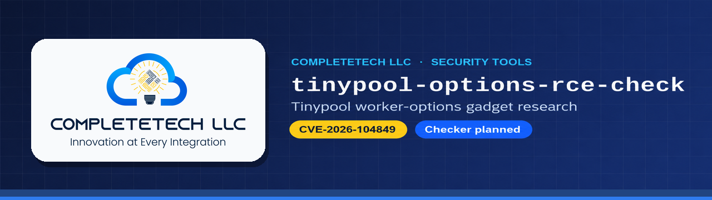
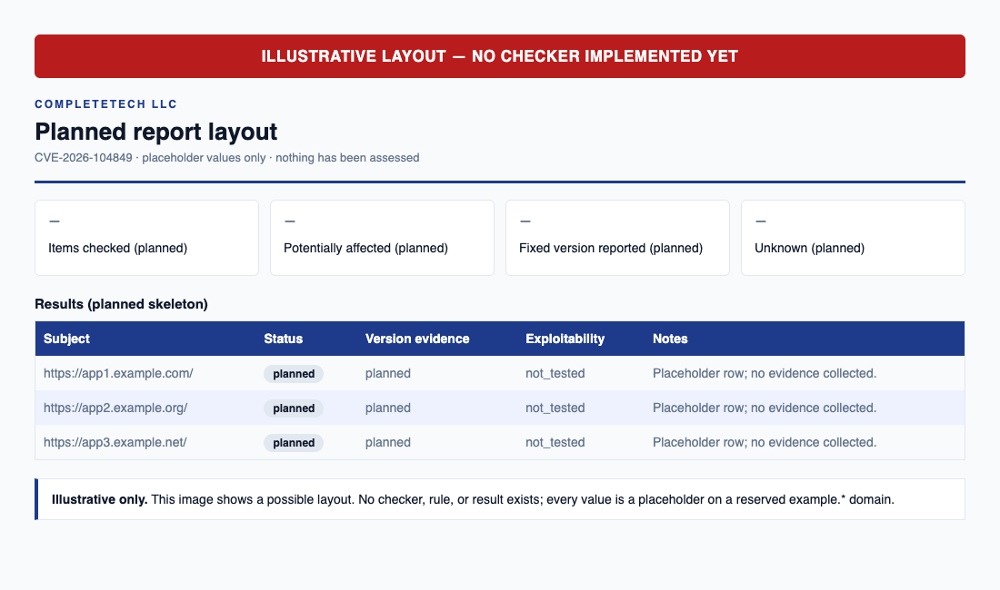

  

  
  
  

  <b>Tinypool worker-options prototype-pollution gadget</b> 
  CVE-2026-104849 · GHSA-85c8-ppgw-ccpr · research only, no checker yet

---

> **Repository initialized; checker implementation pending.**
> This project currently contains research and an implementation checklist.
> It does not assess systems or provide an executable detection rule.

`tinypool-options-rce-check` is the planned home of a checker for **CVE-2026-104849**, a Tinypool worker-options prototype-pollution gadget. Today it holds source-backed research and a work plan only. It sends no requests, runs no exploit payloads, and reports no results. When built, it is meant to report uncertainty honestly: missing, conflicting, or vendor-qualified evidence stays `unknown`, never "safe".

By [CompleteTech LLC](https://complete.tech).

## Status and what is planned

There are no checker commands, installation steps, downloadable binaries, test results, or CI claims, so there is no Quick start yet. To follow or contribute to the work:

1. Review [advisory.json](advisory.json) and the [primary sources](#primary-sources).
2. Work through the exploit-specific [implementation checklist](docs/IMPLEMENTATION.md).
3. Read [AGENTS.md](AGENTS.md), [CONTRIBUTING.md](CONTRIBUTING.md), and [SECURITY.md](SECURITY.md) before contributing.

## Planned report layout

  <picture>
    <source media="(prefers-color-scheme: dark)" srcset="docs/images/report-dark.png">
    
  </picture>

<b>Illustrative only.</b> A layout sketch with placeholder values on reserved <code>example.*</code> domains. No checker, report format, or result exists yet.

## What the results will mean (planned)

The status vocabulary below is planned and taken from this repository's [implementation checklist](docs/IMPLEMENTATION.md). It is not implemented.

| Status (planned) | Intended meaning |
| --- | --- |
| `potentially_affected` | Evidence matches this advisory's documented range or condition. Not confirmed exploitability. |
| `fixed_version_reported` | A supported comparison shows a reported fixed version. Not a guarantee or verified deployed patch. |
| `unknown` | Missing, malformed, conflicting, prerelease, vendor/custom-build, possible-backport, or uncovered-future evidence. |

Exploitability remains `not_tested` for every future finding.

| Reported in the advisory data (research only) | Value |
| --- | --- |
| Affected | `<=2.1.0` (maintainer); `<2.1.2` (GitHub Reviewed) |
| Confirmed affected | `<=2.1.0` |
| Conflicting source evidence | `2.1.1` (must not be reported clean) |
| Fixed in | `2.1.2` |

These values are research-only and come from [advisory.json](advisory.json); they are not an enabled rule.

> [!IMPORTANT]
> **Nothing here is a test result.** The repository is research only and detection is disabled. `pool.run(task)` alone is not the documented trigger, so a version match would never prove exposure or exploitability. A reported fixed version is not a guarantee of safety, and the `2.1.1` source conflict must stay `unknown`.

## One exploit, one repository

| Field | Scope |
| --- | --- |
| Exploit identifier | `CVE-2026-104849` |
| Aliases for this same exploit | `GHSA-85c8-ppgw-ccpr` |
| Research verification date | 2026-10-23 |
| Implementation state | `planned` |
| Detection rule | **Disabled — research only** |

This repository is dedicated to **CVE-2026-104849**. Aliases and multiple affected
products identify this same exploit; they do not create additional scanner scopes.
Future fixes for different vulnerabilities belong in independent repositories.

## Advisory snapshot

The following is source-backed research for implementation planning. It is not a
test result, a live rule feed, or an attestation that a deployed system is patched.

### Affected versions or conditions

<=2.1.0 (maintainer); <2.1.2 (GitHub Reviewed)

### Reported fixes or remediation

2.1.2

### Deployment preconditions to establish

- caller supplies pool.run options object
- options lacks an own filename property
- separate prototype-pollution primitive
- attacker-controlled worker module available

### Evidence notes and limitations

- pool.run(task) alone is not the documented trigger. Surface 2.1.1 source conflict and do not report clean. Maintainer severity High differs from database Critical; retain provenance.

## How it works (planned)

The intended checker follows the evidence and reporting conventions of
[node2shell-check](https://github.com/CompleteTech-LLC/node2shell-check) and [php2shell-check](https://github.com/CompleteTech-LLC/php2shell-check):

- Prefer offline version, inventory, or configuration evidence appropriate to this exploit.
- Keep version state, documented preconditions, evidence provenance, and uncertainty separate.
- Preserve `exploitability: not_tested`; never run exploit payloads or confirm compromise.
- Keep missing, malformed, conflicting, vendor-qualified, prerelease, and uncovered versions `unknown`.
- Produce human-readable findings and machine-readable JSON/CSV; document each output before release.
- Add bounded, explicitly selected passive network behavior only if it provides useful evidence.

These capabilities are **planned**, not implemented. There are currently no
checker commands, downloadable binaries, test results, or CI claims.

## Primary sources

1. [Repository advisory](https://github.com/tinylibs/tinypool/security/advisories/GHSA-85c8-ppgw-ccpr)
2. [GitHub Advisory Database](https://github.com/advisories/GHSA-85c8-ppgw-ccpr)

The research date records the supplied verification snapshot. Recheck primary
advisories before enabling any detection logic, and retain contradictory evidence.

## Documentation

- [Implementation checklist](docs/IMPLEMENTATION.md): local work plan and verification gates
- [advisory.json](advisory.json): source-preserving research record (detection disabled)
- [AGENTS.md](AGENTS.md) · [Contributing](CONTRIBUTING.md) · [Security policy](SECURITY.md)

## License

Dual licensed: [AGPL-3.0](LICENSE), or a separate commercial agreement with CompleteTech LLC. See [LICENSING.md](LICENSING.md) and the [contribution terms](CONTRIBUTING.md#licensing-of-contributions). Names and branding are governed by [BRAND_ASSETS.md](BRAND_ASSETS.md).

Copyright © 2026 CompleteTech LLC.
